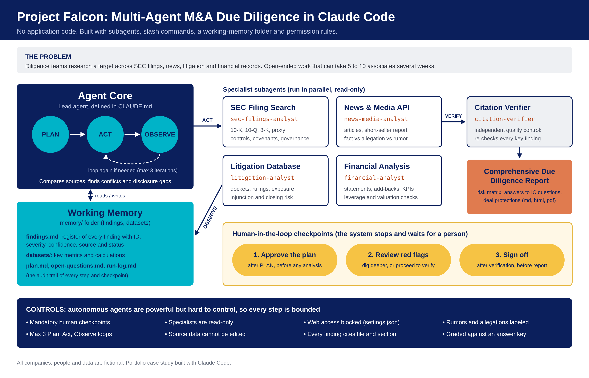

# Project Falcon: Multi-Agent M&A Due Diligence, Built in Claude Code

> **Portfolio case study.** An AI "diligence team" that researches an acquisition target across SEC filings, news, litigation records and financial data, then writes an Investment Committee report. Built entirely with Claude Code features. No application code and no Agent SDK.
>
> All companies, people, court cases, articles and numbers are **fictional**.



## At a glance

- **The task:** due diligence on Talonfield Systems, a (fictional) public robotics company that Arbelion Industries wants to buy for $24.00 per share (about $1.16 billion).
- **The team:** one lead agent and five specialist subagents, running a bounded **Plan -> Act -> Observe** loop.
- **The controls:** three mandatory human checkpoints, read-only specialists, an independent citation verifier, an iteration cap and blocked web access.
- **The proof:** the fictional data contains 18 planted red flags. A built-in answer key and an `/evaluate` command grade how many the system finds.
- **Built like a product:** a product spec, design spec, tech spec and phased plan, each agreed before building, with automated checks for every phase.
- **Results:** across three fully blind graded runs, each in a fresh session that never saw the answer key, the system averaged 97.4% recall on the 13 Critical and High planted issues (range 96.2% to 100%) and 93.5% on all 18, with no unsupported finding in any report and no distractor rated too high. An earlier, partly blind test run is kept as a [sample](examples/sample-run/evaluation/scorecard.md).

## The problem

During M&A due diligence, teams must research target companies across multiple databases, public filings, news, litigation history and financial records. This open-ended investigation can take weeks for teams of 5 to 10 associates. Autonomous agents can help, but they are the hardest AI pattern to control, so high-stakes work needs human checkpoints.

## How the architecture maps to Claude Code

| Architecture component | Built with | Files |
|---|---|---|
| **Agent Core** (Plan -> Act -> Observe) | Lead agent instructions | `CLAUDE.md` |
| **SEC Filing Search** | Subagent + simulated filings | `.claude/agents/sec-filings-analyst.md`, `data/sec-filings/` |
| **News & Media API** | Subagent + simulated news feed | `.claude/agents/news-media-analyst.md`, `data/news/` |
| **Litigation Database** | Subagent + simulated court dockets | `.claude/agents/litigation-analyst.md`, `data/litigation/` |
| **Financial Analysis** | Subagent + financial data | `.claude/agents/financial-analyst.md`, `data/financials/` |
| **Working Memory** (findings, datasets) | A folder of Markdown files | `memory/` |
| **Comprehensive Due Diligence Report** | Report step with a print stylesheet | `output/`, `templates/report-style.css` |
| **Human-in-the-loop checkpoints** | Three mandatory stops | `CLAUDE.md` |
| Added: quality control | Independent citation verifier | `.claude/agents/citation-verifier.md` |
| Added: guardrails | Permission rules (no web, read-only data) | `.claude/settings.json` |
| Added: evaluation | Answer key and grading command | `evaluation/`, `/evaluate` |
| Added: one-word commands | Slash commands | `.claude/commands/` |

## How a run works

1. **Plan.** The lead agent reads the deal brief, maps the Investment Committee's six questions to the analysts, writes hypotheses and a task list to `memory/plan.md`. **Checkpoint 1: a human approves the plan.**
2. **Act.** Four specialists work in parallel, each on its own source, and return findings in a standard format: ID, evidence, source, severity, confidence and what to cross-check.
3. **Observe.** The lead agent records every finding in the findings register, then compares sources. Most of the serious issues only appear here: a court ruling the company's filing leaves out, a one-off revenue amount from a footnote that changes the growth story, a deal model built on guidance that was later cut. It loops again only if a Critical or High question is still open (maximum 3 loops). **Checkpoint 2: a human reviews the red flags and decides whether to dig deeper.**
4. **Verify.** An independent citation verifier re-opens every cited source and re-checks every Critical and High finding. **Checkpoint 3: a human signs off.**
5. **Report.** The lead agent writes the report: a recommendation, the top red flags, answers to the six IC questions, a risk matrix, cross-source insights, deal protections and a management request list.

## Design choices

- **Specialists by source, not by topic.** This mirrors the architecture's tools and forces the important work, connecting sources, into the lead agent's Observe step.
- **Separation of duties.** Analysts cannot edit anything. A separate verifier checks their work, like a reviewer on a real deal team.
- **Severity and confidence are separate.** A rumor can matter a lot and still be unconfirmed. The report labels facts, allegations and rumors.
- **Memory as plain files.** Anyone can open `memory/` and audit every finding, decision and checkpoint. The run survives a restart.
- **Bounded autonomy.** A 3-loop cap, stop conditions and human checkpoints keep the agents on a short leash.
- **Measured, not assumed.** Planted issues and an answer key turn "it seems to work" into a score you can improve.

## How it was planned and tested

- **Project Memory:** the [product spec](Project%20Memory/product-spec.md) (28 requirements), [design spec](Project%20Memory/design.md), [tech spec](Project%20Memory/tech-spec.md) (architecture, data model and 11 critical risks) and the phased [plan](Project%20Memory/progress.md), each agreed before building. They are also published as a [website](https://claude.ai/artifact/CmFqn6PUnPvRse4GxpLrDW) with live plan ticks.
- **Automated checks:** 34 checks using only Python's standard library, for every phase: read-only agents and guardrails, data that ties out and has not changed, complete runs and reports, graded scorecards and house style. Type `/run-tests`, or run `python3 tests/run_all.py`. Add `--run examples/sample-run` to check the saved run.
- **One-page case study:** [docs/case-study.pdf](docs/case-study.pdf).

## Sample run

A complete test run from October 18, 2026 is saved in [`examples/sample-run/`](examples/sample-run/).

**Proposed recommendation: do not proceed at $24.00 per share.** At the deal model's own multiple, current guidance supports $12.60 to $14.50 per share. The three Critical issues: a valuation built on guidance the target had already replaced, a patent case that turned against the target (with an injunction sought on robots behind about 42% of revenue), and a 31% customer that can leave after a change of control. Read the [report (PDF, 15 pages)](examples/sample-run/output/Project-Falcon-Due-Diligence-Report.pdf).

| Step | What happened |
|---|---|
| Plan | 6 IC questions and 4 hypotheses; approved at Checkpoint 1 |
| Iteration 1 | 4 analysts in parallel: 59 findings. The lead agent added 15 cross-source findings and 5 conflicts between sources |
| Iteration 2 | 5 narrow follow-ups (covenant headroom, what the 10-Q leaves out, normalized revenue and valuation): 15 more findings |
| Verify | 61 findings re-checked by 4 verifier runs in parallel: 44 verified, 17 corrected, 0 rejected |
| Report | Approved at Checkpoint 3. 69 minutes from plan to sign-off; 10 subagent runs; about 1.95 million subagent tokens |

**Scorecard** (graded with `/evaluate` against the answer key):

| Metric | Result | Target |
|---|---|---|
| Recall, the 13 Critical and High planted issues | 100% | at least 80% |
| Recall, all 18 planted issues | 97.2% (17 found, 1 partially found) | |
| Severity within one level of the answer key | 100% | |
| Unsupported findings in the report | 0 | 0 |
| Distractors rated Medium or above | 0 of 4 | 0 |

**What the evaluation changed.** The one partial miss (goodwill impairment risk) was found by three agents but never reached the report, because only higher-severity findings were verified. That, a trend spread across five findings and verifier corrections applied late became three fixes to `CLAUDE.md`, applied after this run.

**How blind was it?** The analysts and verifiers never saw the answer key. The lead agent ran in the same Claude Code session that built the data, and the checkpoints were approved by the builder. The three graded runs below fix that: each ran in a fresh session.

**Three blind graded runs.** After the three fixes, I ran the system three more times, each in a fresh Claude Code session that never saw the answer key or an earlier run. The setup was frozen across the three, so the scores measure how much results vary from run to run.

| Metric | Run 1 | Run 2 | Run 3 | Average | Range |
|---|---|---|---|---|---|
| Recall, the 13 Critical and High planted issues | 96.2% | 96.2% | 100% | 97.4% | 96.2% to 100% |
| Recall, all 18 planted issues | 94.4% | 91.7% | 94.4% | 93.5% | 91.7% to 94.4% |
| Severity within one level of the answer key | 100% | 100% | 100% | 100% | |
| Unsupported findings in the report | 0 | 0 | 0 | 0 | |
| Distractors rated Medium or above | 0 of 4 | 0 of 4 | 0 of 4 | 0 | |

The same gaps showed up more than once: goodwill impairment risk was only partly found in all three runs, the planted positives were thin in every report, and a lawsuit by the #4 customer was not linked to that customer's revenue in two of the three. Those are the next instruction fixes. Run 2's own scorecard reports 96.4% because it counted 14 Critical and High issues; the table recomputes every run on the answer key's 13. Scorecards: [run 1](runs/2026-10-18_0921/evaluation/scorecard.md), [run 2](runs/2026-10-18_1336/evaluation/scorecard.md); run 3's is in `evaluation/scorecard.md`.

Inside the run: the [findings register](examples/sample-run/memory/findings.md), the [run log](examples/sample-run/memory/run-log.md) with all three checkpoints, every analyst's [unedited report](examples/sample-run/memory/analyst-reports/), the [verifier reports](examples/sample-run/memory/verification/) and the [scorecard](examples/sample-run/evaluation/scorecard.md).

## Repository structure

```
CLAUDE.md                  Lead agent: the Plan -> Act -> Observe loop, checkpoints, report template
.claude/
  agents/                  5 subagents (4 source specialists + citation verifier)
  commands/                /diligence, /diligence-status, /evaluate, /reset-memory, /run-tests
  settings.json            Guardrails: no web access, sources read-only, approval to open evaluation/ or earlier runs
data/                      Simulated sources (fictional): filings, news, dockets, financials, deal brief
memory/                    Working memory (blank, ready for your run)
templates/                 Blank memory files and the report stylesheet
output/                    Where the report is written
evaluation/                Answer key of planted issues (+ scorecard after /evaluate)
examples/sample-run/       A complete test run: memory, report (PDF) and scorecard
tests/                     34 automated checks (Python standard library), run with /run-tests
Project Memory/            Product spec, design spec, tech spec and phased plan
docs/                      Architecture diagram, run guide, one-page case study
```

## Run it yourself

Open the folder in Claude Code and type `/diligence`. Reply at the three checkpoints. Full guide: [docs/how-to-run.md](docs/how-to-run.md).

For a truly blind test, start a fresh Claude Code session in the folder, run `/diligence`, then `/evaluate` and compare your scorecard with the sample run. Claude Code asks before any agent can open the answer key, a scorecard or an earlier run.

## From demo to a real deal

- Replace the simulated folders with real sources: filings downloaded from SEC EDGAR, a news feed or news connector, court records (for example docket exports), and the virtual data room.
- Connect internal systems through admin-approved, read-only connectors, and confirm data handling terms (for example plan type and data retention) with your firm's IT and compliance teams before using client data.
- Keep the human checkpoints. They are the point.

## Limitations

- The simulated data is cleaner and smaller than a real data room.
- In the sample run, the human checkpoints were approved by the builder, not by an Investment Committee member, and the lead agent ran in the session that built the data. Only the analysts and verifiers were blind.
- AI output can still be wrong. The verifier reduces errors but does not remove the need for expert review.
- Nothing here is investment, legal or accounting advice.

## Skills demonstrated

- **AI product management:** framing the problem and the users, product, design and tech specs, a phased plan with acceptance tests, success metrics set up front, and product changes driven by measured results.
- **Evaluation:** planted ground truth (18 issues and 4 distractors), a blind answer key, recall and severity scoring, an independent verifier, and honest reporting of the test's limits.
- **Agentic workflow design:** multi-agent orchestration, bounded autonomy, human-in-the-loop checkpoints, least-privilege guardrails and prompt-injection defense.
- **Domain depth (M&A due diligence):** revenue quality, cash conversion, EBITDA add-backs, covenant analysis, litigation exposure, disclosure gaps, governance and deal protections.
- **Communication:** an Investment Committee-ready report, a one-page case study and a clear audit trail.
